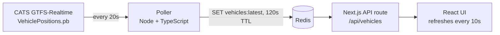

# Charlotte Transit Live

Live positions of Charlotte Area Transit System (CATS) buses and light rail, built on the agency's public GTFS-Realtime feed. I'm building it to learn a modern backend stack hands-on: containers, caching, event streaming, and cloud deployment.

> Status: **step 1 of 7.** Poller, Redis, and web UI run locally in Docker. Kafka, Postgres, and AWS are next (see [Roadmap](#roadmap)).

<!-- TODO: add a screenshot here -->

## Quickstart

Requires Docker.

```bash
docker compose up --build
```

Then open <http://localhost:3000>. The first vehicles appear after the poller's first fetch (a few seconds).

Useful commands:

```bash
docker compose logs -f poller   # see each poll and how many vehicles were stored
docker compose exec redis redis-cli GET vehicles:latest | head -c 300
```

### Without Docker (for development)

```bash
docker compose up redis -d

cd services/poller && npm install && npm run dev
cd apps/web        && npm install && npm run dev
```

## Architecture (current)



- **Poller** (`services/poller`): fetches the protobuf feed, decodes it, and stores a snapshot in Redis. It is a separate long-running process on purpose, because Next.js route handlers are request-scoped and are the wrong place for a polling loop. See [ADR 001](docs/001-separate-poller.md).
- **Redis**: holds the latest snapshot with a TTL, so if the poller dies the UI shows an error instead of stale data pretending to be live.
- **Web** (`apps/web`): Next.js (App Router) + React. The API route reads from Redis, so browsers never hit CATS directly.

## Roadmap

- [x] Poller + Redis + Next.js UI in Docker Compose
- [ ] Load static GTFS (`GTFS.zip`) into Postgres so routes and stops have real names
- [ ] Put poller output on a **Kafka** topic; consumers update Redis and write history to Postgres
- [ ] Trip updates (delays) and service alerts feeds
- [ ] Map view
- [ ] Deploy to **AWS** with Terraform (billing alert first)
- [ ] Observability: structured logs and a basic dashboard

## Data and attribution

Transit data: Charlotte Area Transit System, GTFS-Realtime. This is an independent project and is not affiliated with or endorsed by CATS.

## What I learned

<!-- Fill this in as you go. This section is what you'll talk about in interviews:
     what broke, what surprised you, what you'd do differently. -->
# cats-live
